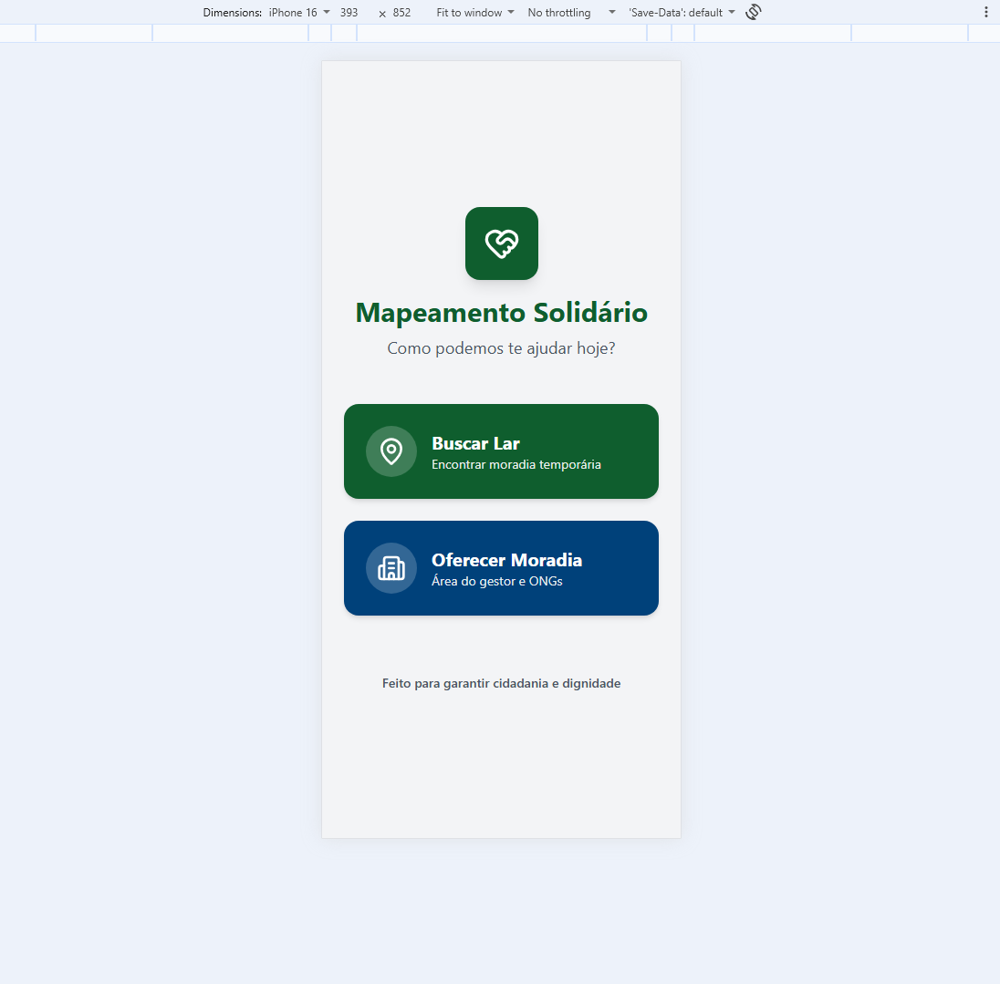
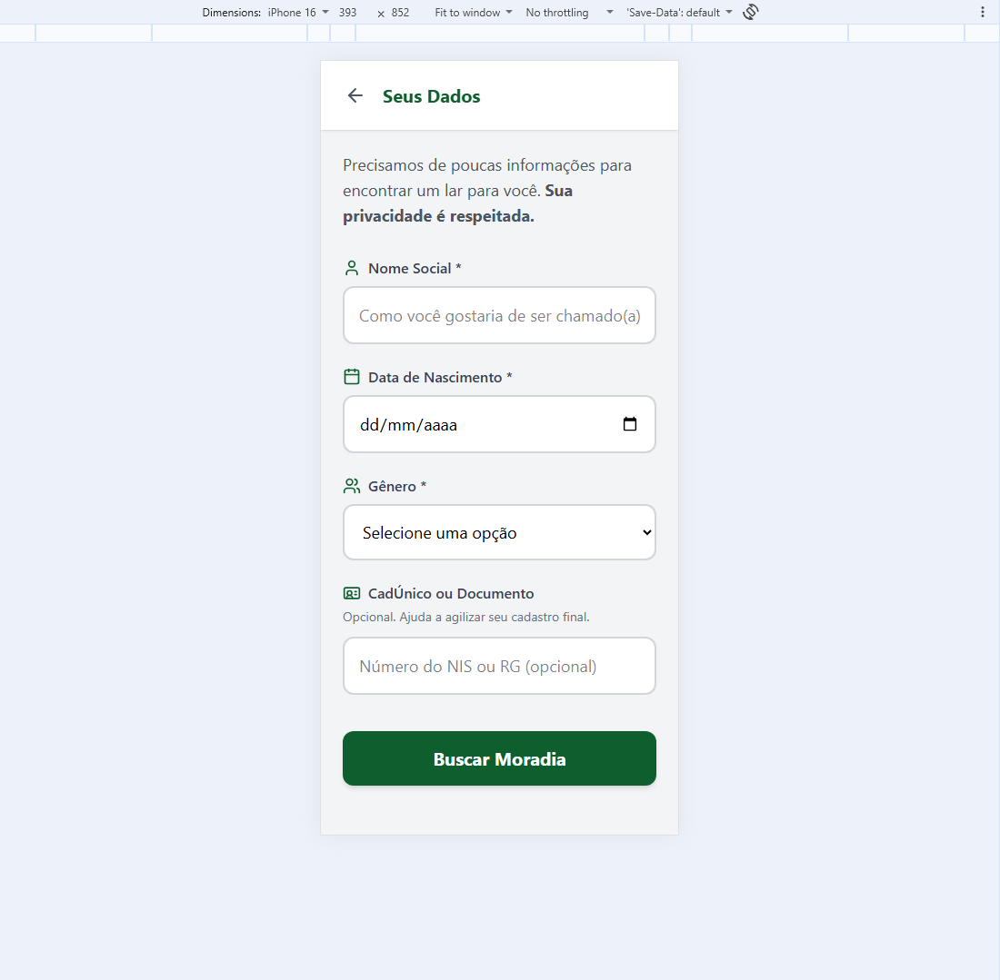
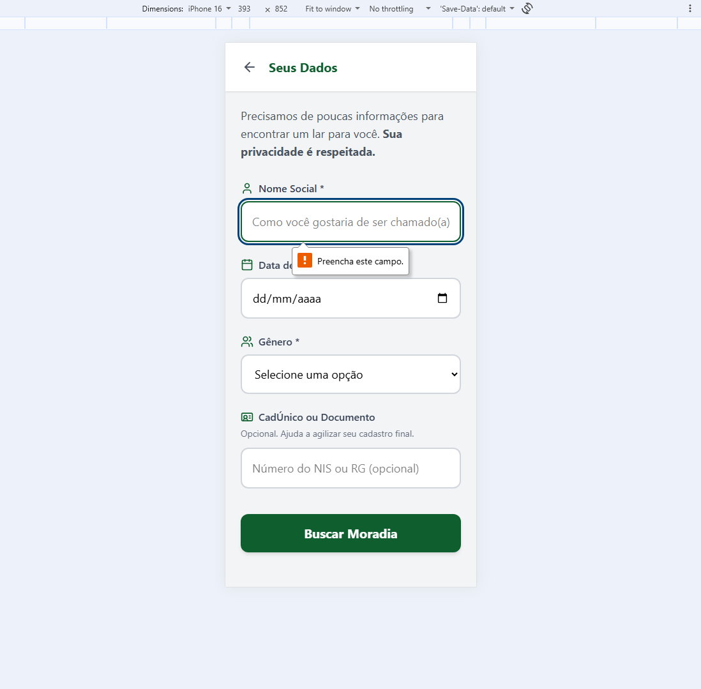
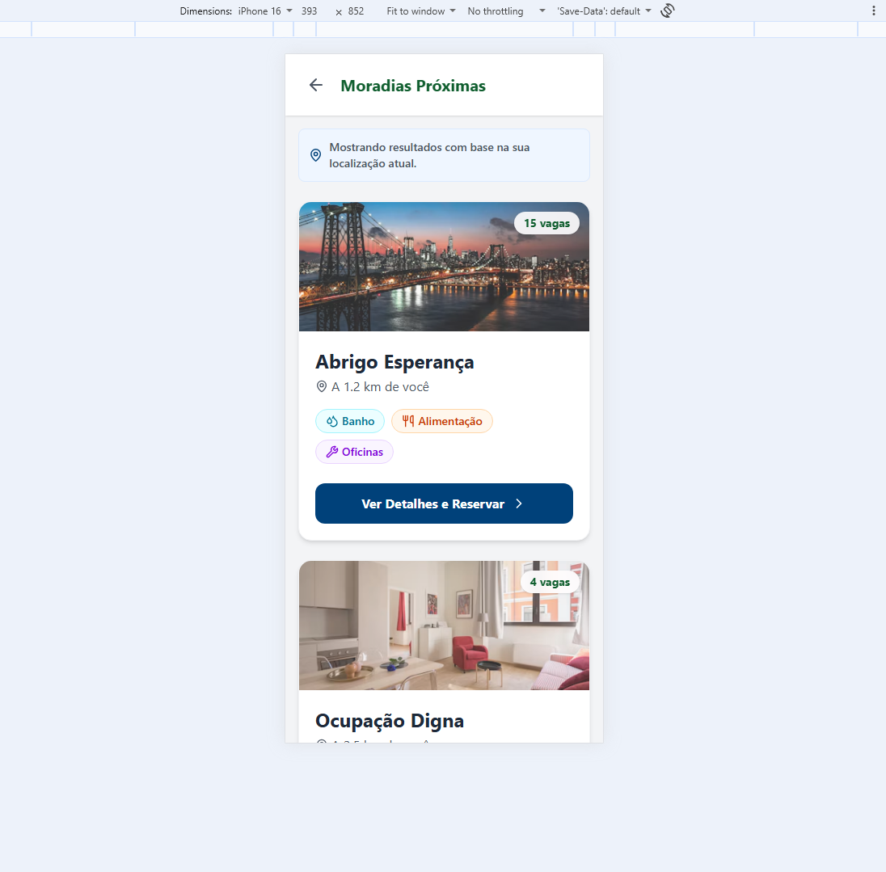
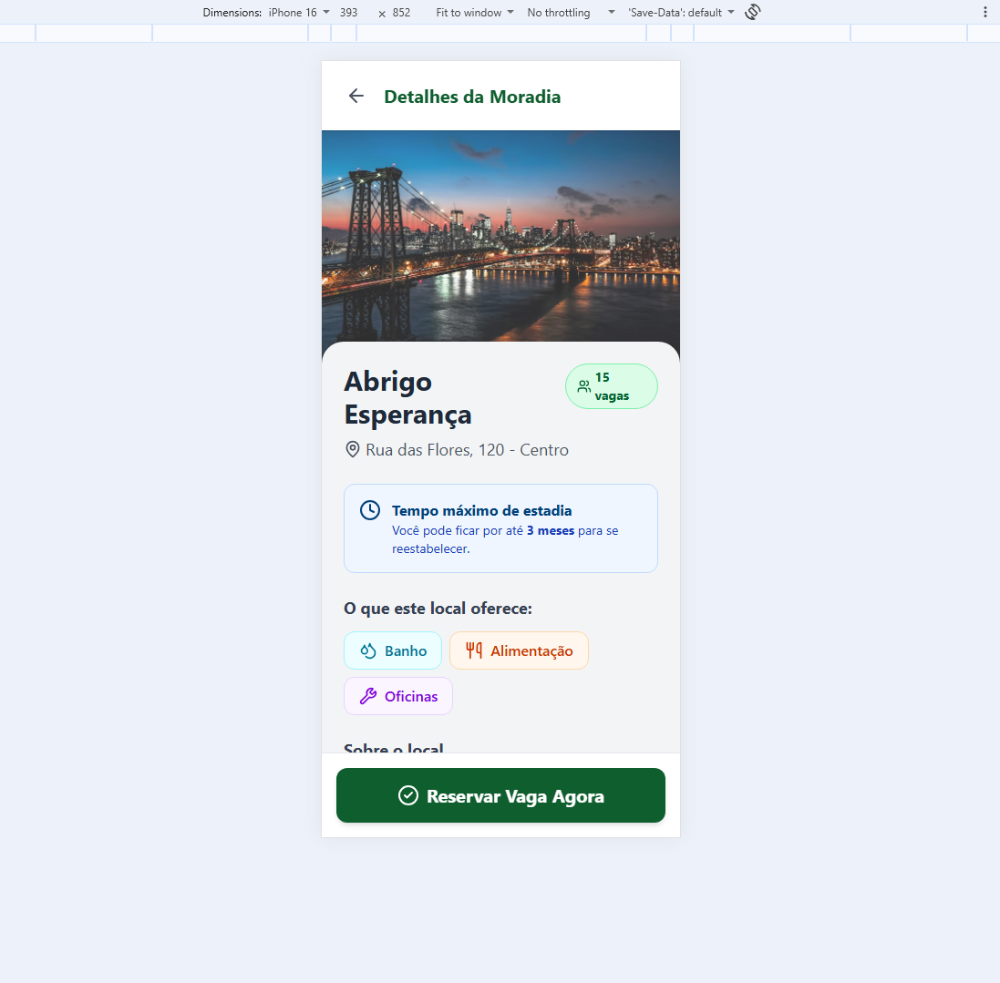
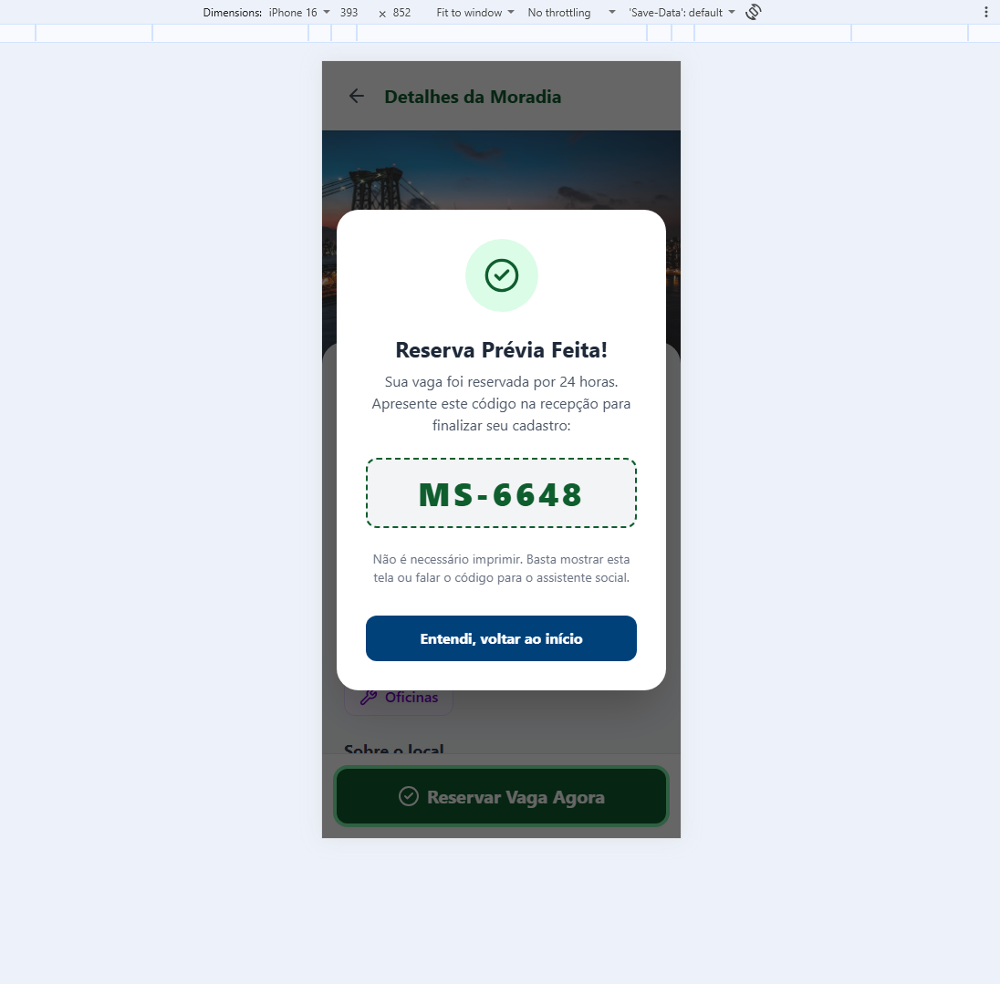

# 👤 Fluxo do Morador (Público-Alvo)

Este fluxo foi desenhado com **baixo atrito**, para ser utilizado por pessoas que podem estar em situação de rua, sem acesso a computadores ou com baixo letramento digital.

## 1. Tela Inicial
A tela inicial apresenta duas opções claras: buscar um lar ou oferecer moradia. Os botões possuem alto contraste e são grandes (mínimo 44x44px), facilitando o toque.

## 2. Identificação
O morador informa apenas o essencial: **Nome Social** (respeitando a identidade de gênero), Data de Nascimento e Gênero. O documento (CadÚnico ou RG) é **opcional** nesta etapa, servindo apenas para agilizar o processo final.

O sistema conta com **Prevenção de Erros (WCAG 3.3.1)**: se o usuário tentar avançar sem preencher os campos obrigatórios, uma mensagem de erro clara é exibida em vermelho.

## 3. Busca de Moradias
O feed mostra as moradias próximas com base na localização. As fotos possuem **opacidade reduzida** para que as informações textuais (vagas, distância e serviços) sejam o foco principal. Ícones acompanhados de texto indicam Banho, Alimentação e Oficinas (sem depender apenas da cor).

## 4. Detalhes e Reserva
Ao clicar em um imóvel, o morador vê os detalhes, o tempo máximo de estadia e as regras. O botão "Reservar Vaga Agora" é fixo no rodapé para facilitar o alcance do polegar.

## 5. Código de Pré-Reserva
Após confirmar, o morador recebe um **código de identificação** (ex: `MS-4829`). Ele deve apresentar esse código na recepção do abrigo para finalizar o cadastro. 

> **Design Contextual:** O morador não preenche um formulário longo na rua. A pré-reserva digital garante a vaga, e o cadastro completo é feito presencialmente no abrigo, com apoio de um assistente social.

\newpage