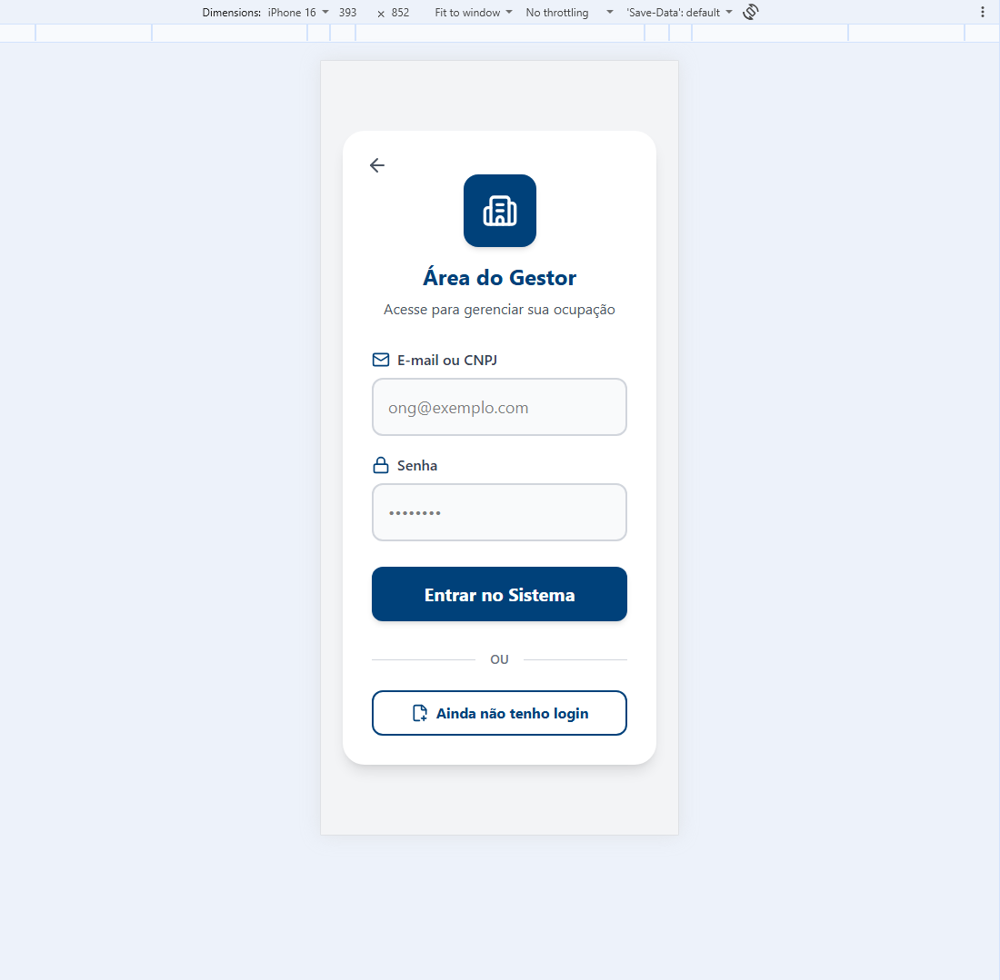
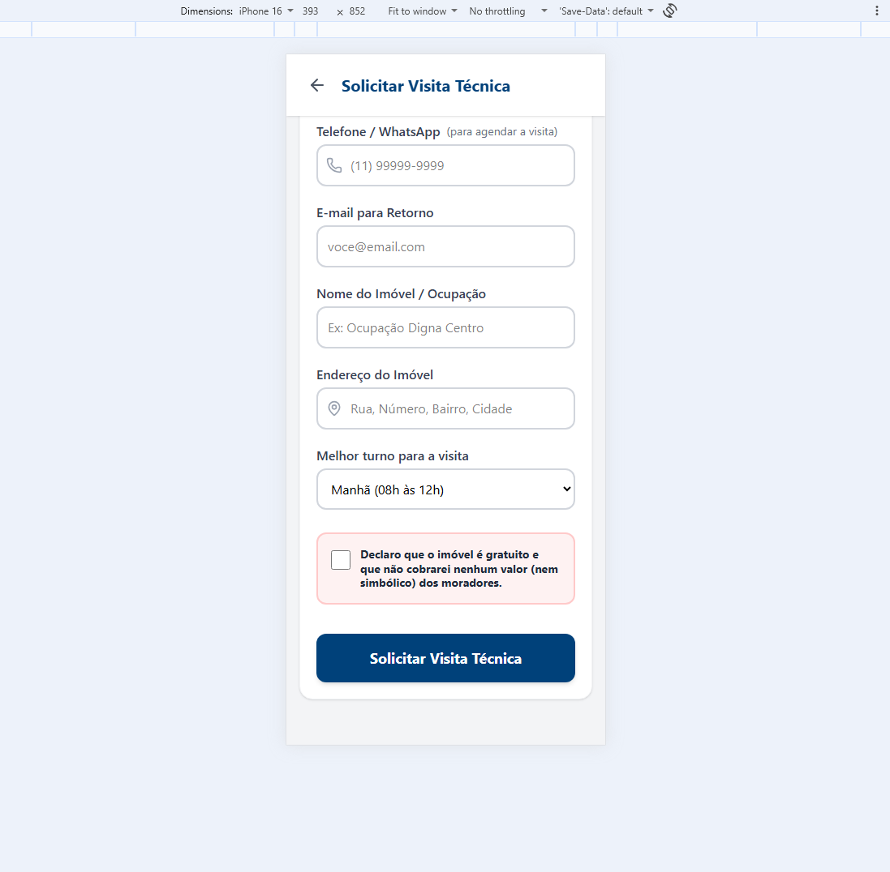
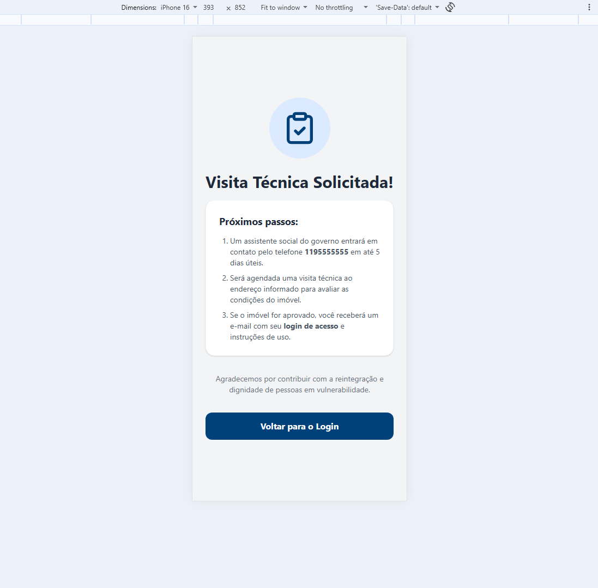
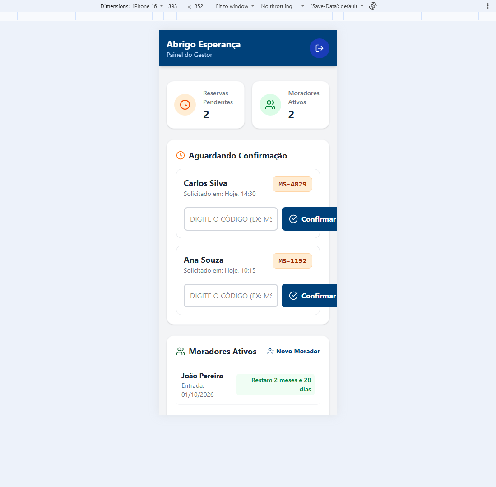
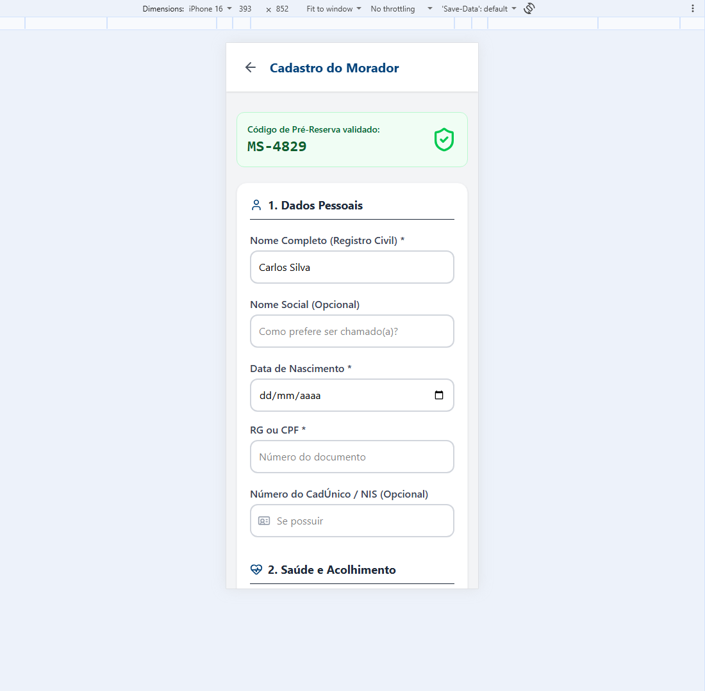
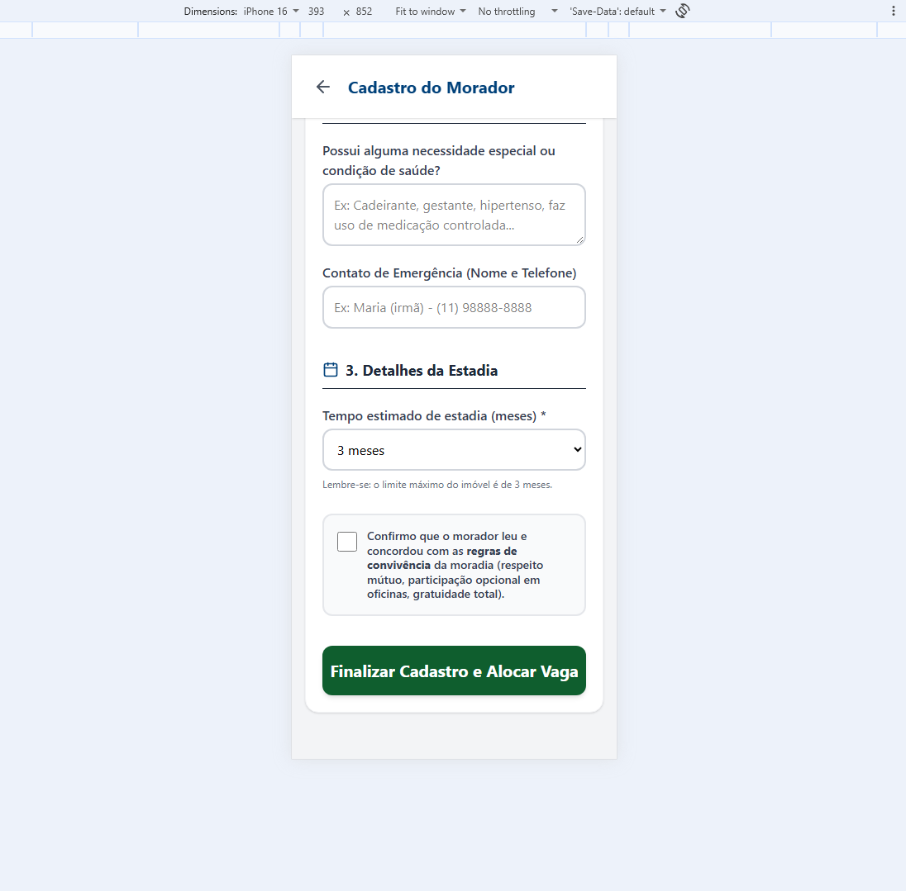
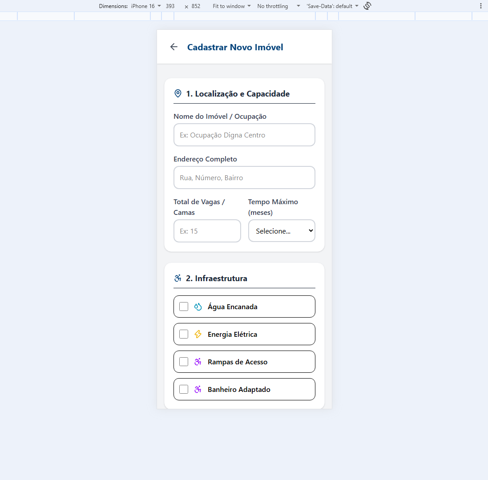
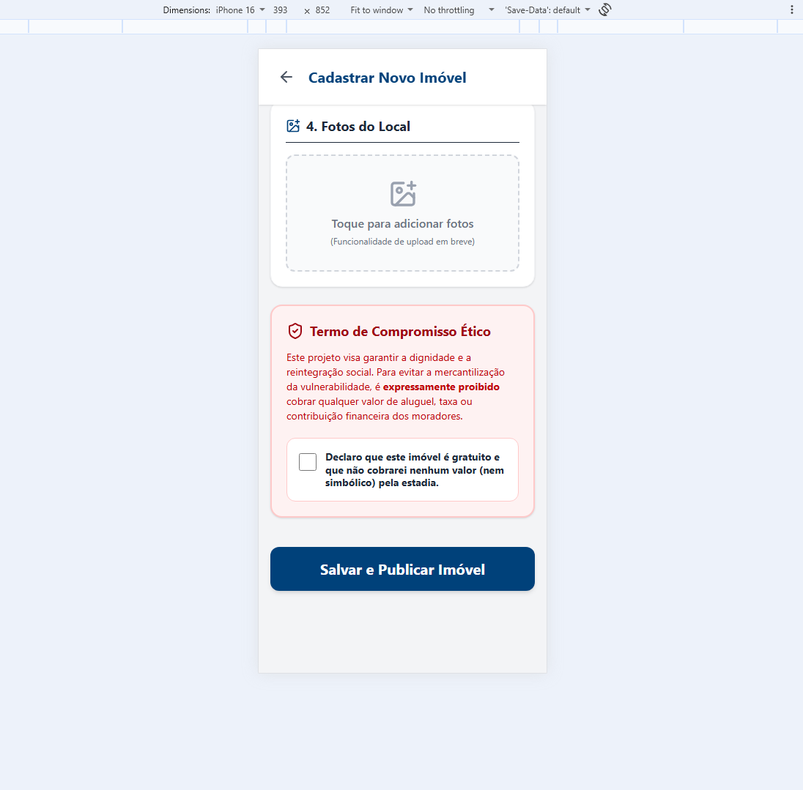

# 🏢 Fluxo do Gestor (ONGs e Ocupações)

Este fluxo é destinado a assistentes sociais, líderes comunitários e ONGs que administram os imóveis.

## 1. Login e Solicitação de Acesso
Gestores já aprovados acessam com e-mail e senha. Quem ainda não tem login clica em **"Ainda não tenho login"** para solicitar uma **Visita Técnica** do Governo.

## 2. Solicitação de Visita Técnica
O gestor informa seus dados de contato (incluindo telefone/WhatsApp), o endereço do imóvel e o melhor turno para a visita. Ele **precisa aceitar o Termo de Compromisso Ético** (gratuidade total) antes de enviar.

## 3. Dashboard do Gestor
Após a aprovação do Governo, o gestor recebe o login. No painel, ele pode ver:
*   **Reservas Pendentes:** Moradores que fizeram pré-reserva (com o código).
*   **Moradores Ativos:** Quem já está no abrigo e o tempo restante de estadia.

## 4. Cadastro Completo do Morador

Ao digitar o código do morador (ex: `MS-4829`), o gestor é redirecionado para a tela de **Cadastro Completo**. O nome e o código já vêm pré-preenchidos. Aqui são coletados dados mais sensíveis: RG/CPF, CadÚnico, necessidades especiais de saúde e contato de emergência.

Como este formulário é extenso (dividido em 3 seções para evitar a sobrecarga cognitiva do gestor), apresentamos a tela em duas partes:

### Parte 1: Dados Pessoais e Validação do Código
No topo, o gestor confirma que o código do morador foi validado (caixa verde). Em seguida, preenche os dados do registro civil, incluindo o Nome Social (respeitando a identidade de gênero) e o CadÚnico (opcional, mas importante para o acompanhamento social).

### Parte 2: Saúde, Estadia e Regras
Na parte inferior, o gestor registra necessidades especiais de saúde (essencial para o acolhimento adequado), define o tempo estimado de estadia e confirma que o morador leu as regras de convivência antes de finalizar o cadastro.

> **Nota de IHC (Lei de Miller):** A divisão em seções e a apresentação em duas partes no manual refletem a estratégia de **"Chunking"** (agrupamento de informação), que reduz a carga cognitiva e evita que o usuário se sinta sobrecarregado ao preencher um formulário longo.

## 5. Cadastro de Novo Imóvel
O gestor pode cadastrar novos imóveis informando infraestrutura (água, luz, rampas, banheiros adaptados), serviços (oficinas) e fotos. O **Termo Ético** é obrigatório.

